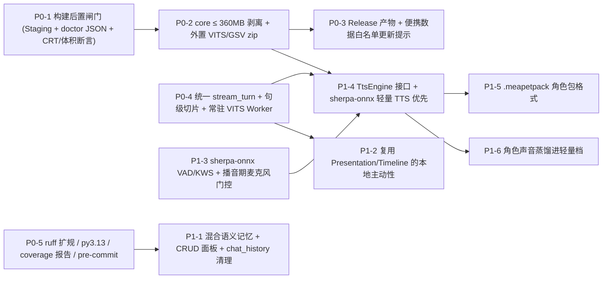

# MeaPet PC 现状评估、发展路线图与执行方案

> 原始审计：`2026-10-24`（纯只读审计，基线 `c280ba4`）
> 初版沉淀：`2026-11-01`（`6719df0`，核对至 `f45fbe9`）
> 全仓清查与方案优化：`2026-11-08`（核对至当前 HEAD `fde7ef4`，含 `dist/` 实测与代码路径复核）
> 原则：**已落地的不再重复开工；每项设计对齐仓内现有契约；每项上线必须带可复现的度量读数**。

---

## 0. 战略判断（冻结接入面，押注手感与存在感）

仓内接入面（直连 4 协议 / 3 种 Agent / Companion MCP / OneBot v11 双向 + hub / `dsh-onebot-relay` / Live2D + PNG / Wayland layer-shell）已经足够宽。**未来 6 个月冻结新增接入协议**，把工程预算集中到四个“存在感与手感”主轴：

1. **她进得去你已有的工具链**（Agent Link / Companion MCP / QQ —— 这是护城河，只维护不扩新协议）；
2. **她一直在，且轻装可升级**（core 包 `≤ 360 MB`、装完即跑、构建有门禁、更新不丢记忆与配置）；
3. **她秒回且音画合拍**（直连与 Agent 统一流式、句级语音流水线、外置引擎热驻留）；
4. **她记得、也会主动开口**（混合语义记忆 + 可见可改界面、不打扰的本地主动性、全双工低误触语音输入）。

---

## 1. 全仓清查实测基线（HEAD `fde7ef4`，2026-11-08 核对）

### 1.1 代码库与质量面实测读数

| 指标 | 初版审计（`c280ba4`） | 本次复核（`fde7ef4`） | 关键发现 |
|---|---|---|---|
| 提交数 / 跟踪文件 | 645 / 905 | **650 / 907** | 近两周主要补齐 Windows 冻结包与 CI 测试契约 |
| Python 代码行数 | ≈ 124,000 | **124,324** | 最重文件：`render_host.py`(3,200)、`wizard/app.py`(1,856)、`wizard/live2d_viewport.py`(1,718)、`chat_flow.py`(1,633)、`tts/service.py`(1,428)、`memory/db.py`(1,392)、`config/store.py`(1,391)、`doctor.py`(1,322) |
| 测试函数（`def test_`） | 1,668 | **1,675** | 新增包形状、doctor 编码、torch 并发锁护栏测试 |
| `meapet/` `getattr(self,` | 435 | **437** | `MeaPet` 主类仍继承 11 个 Mixin；`tests/test_mixin_contracts.py` 已承担接口防线 |
| `meapet/` `except Exception` | 360（112 处 `pass`） | **360（110 处 `pass`）** | 长跑稳定性风险仍在，需增量防新增 |
| `ruff` / `coverage` / 3.13 | ruff 仅语法级；无覆盖率；CI 无 3.13 | `pyproject.toml` **已配好 `[tool.coverage.*]`** | 只需在 `.github/workflows/python-app.yml` 接入 pytest-cov 与 3.13 矩阵 |

### 1.2 本地冻结包 `dist/MeaPet` 实测构成（`09b97a2`，2026-10-25 构建）

原文档按 `2026-10-05` 快照写“1.6 GB（已瘦身 290 MB，需重测）”。本次实盘重测 `dist/MeaPet` 实际总体积为 **1,336.1 MB**（Python 3.13，`python313.dll` 6.81 MB），其中 `PyQt5/Qt5/bin` 下的 4 个旧 CRT **已彻底清零**：

| 目录 / 文件 | 实测体积 | 归属判断 | 说明 |
|---|---:|---|---|
| `_internal/torch` | 372.65 MB | 仅 VITS/GSV 本地权重引擎 | `core` 剥离主力 |
| `_internal/models` | 276.81 MB | 仅 GPT-SoVITS | 应拆出为按需扩展包 |
| `_internal/vits_models` | 151.55 MB | 仅 VITS | 应拆出为按需扩展包 |
| `_internal/dic` | 102.33 MB | 仅日文 VITS（`open_jtalk`） | 应拆出为按需扩展包 |
| `_internal/PyQt5` | 81.67 MB | `core` 必需 | 后续可裁未用 Qt 插件，暂不激进 |
| `_internal/scipy` + `scipy.libs` | 69.84 MB | **仅 VITS 使用** | `grep` 验证 `meapet/` 除 `vits_infer`/`vits_runtime` 外零导入 |
| `MeaPet.exe` | 51.9 MiB | `core`（含内嵌 `PYZ`） | 非“旧构建残留”，`EXE(..., exclude_binaries=True)` 把纯 Python 字节码打入其中；剥离 `torch`/`scipy` 后会同步缩水 |
| `_internal/sprites` | 34.21 MB | `core`（默认角色立绘） | P1-5 角色包化后可逐步解耦 |
| `_internal/jieba` | 29.58 MB | `core`（记忆分词） | 保留 |
| `_internal/meapet` | 27.30 MB | `core`（含字体 `LXGWWenKai-Regular.ttf` 24.4 MiB） | 内置字体占该目录约 93% |
| `_internal/numpy` + `numpy.libs` | 25.82 MB | `core`（`fidus_position` / `voice` / 音频处理） | 保留 |
| `_internal/PIL` + `cryptography` + `libcrypto` + `lxml` + `live2d` + `pydantic_core` + `qh3` 等 | ≈ 85 MB | `core` 基础与网络/渲染依赖 | 保留 |
| `_internal/opencc` / `eng_to_ipa` / `pypinyin` / `GPT-Sovits` / `_soundfile_data` | ≈ 26 MB | 除 `opencc` 被 `click_feedback.variants` 可选使用外，其余主要服务 VITS/GSV | 拆离 VITS 后可一并移出 |

> **体积测算结论**：仅剥离 VITS/GSV 独占的 `torch` + `scipy*` + `models` + `vits_models` + `dic` + 文本前端（约 **988 MB**，还不算 `MeaPet.exe` 内嵌 `PYZ` 随 `torch`/`scipy` 减小的部分），`core` 即可直接落到 **~320–350 MB**，稳定满足 `≤ 360 MB` 目标。

### 1.3 审计后已落地项（勿重复开工）

| 审计结论 | 状态 | 落地提交与说明 |
|---|---|---|
| 打包版 torch `WinError 1114`（`PyQt5/Qt5/bin` 四份 2018 CRT 毒化进程） | ✅ 已修 | `09b97a2` + `296484b`：`MeaPet.spec` 新增 `filter_qtbin_crts`，`tests/test_windows_package_shape.py` 钉住规则 |
| 排除无用重包（`av/librosa/llvmlite/numba/pandas/sklearn/torchaudio/transformers`） | ✅ 已修 | `09b97a2` 已在 `MeaPet.spec`（`VITS_TRIM_EXCLUDES`）全部排除，体积从 ~1.59 GB 降至 **1,336.1 MB** |
| `vits_core` 文本前端 10 个包漏打 + torch 并发导入锁 + doctor GBK 崩溃 | ✅ 已修 | `09b97a2` 修复；`tests/test_doctor.py`、`tests/test_vits_deps_probe.py` 已覆盖 |

### 1.4 本次清查暴露出的方案冲突与半成品现状（优化依据）

1. **P0-2 方案冲突（Python 3.13 + 冻结态禁用 `pip`）**：
   - `docs/troubleshooting.zh-CN.md` 已实测钉死：`pyopenjtalk-prebuilt` 无 cp312+ wheel，而当前 Windows 冻结包基于 Python 3.13，`vits_core/text/cleaners.py` 模块级导入会直接导致进程内 VITS 不可用；同时 `wizard/env_utils.py:pip_install()` 在冻结态直接返回 `False`。因此 **原文档“复用 `auto_install_deps`（pip）在向导内安装本地 VITS”对冻结包行不通**，必须改用“独立扩展包（zip + sha256 解压并配置 `tts.vits_python`）+ 轻量 ONNX 引擎”。
2. **P0-3 路径冲突（便携 `_internal` 与更新器边界）**：
   - `meapet/paths.py:get_data_dir()` 在冻结态返回 `sys._MEIPASS`（`dist/MeaPet/_internal`），且 `tests/test_frozen_paths.py` 显式锁定该便携契约。若直接覆盖升级或引入 `tufup`，必须定义**用户数据/扩展包保护白名单**，否则会误删 `config.json` 与 `mea_memory.db`。
3. **P0-4 半成品与冷启动陷阱**：
   - `meapet/chat/engine.py:stream_turn()` 与 `meapet/direct/conversation.py`、`meapet/agent/presentation.py` 已实现并有 `tests/test_direct_chat_flow.py` 护栏，但 `meapet/desktop/chat_flow.py:_make_chat_worker()` 仍将直连模式分派给非流式 `ChatWorker(quick_chat_async)`。
   - `meapet/tts/engines/vits.py:_speak_vits_subprocess()` 每次合成都调用一次 `subprocess.run(vits_infer.py)`，若切句后仍逐句冷启动 `torch`，首音延迟反而恶化；必须配套**常驻子进程推理 worker**。
4. **P1-3 冻结态依赖缺口**：
   - `sherpa-onnx` 与 `pyaudio` 目前仅在 `meapet/dependencies.py` 的安装清单里，未进入 `MeaPet.spec` 或 `pyproject.toml`，导致冻结版无法使用语音输入；而 `sherpa-onnx` 本身同时内置了 Silero VAD、KWS 与轻量 ONNX TTS 能力，可作为语音输入 + 轻量本地 TTS 的统一底座。
5. **P1-1 记忆面现况**：
   - `StatusPanel` 仅只读展示 4 条重要记忆，`TimelineDialog` 仅只读展示轮次；`chat_flow.py`（`_finish_agent_turn`，第 997–1044 行）在 `agent` 模式下走会话记录并跳过本地 `_do_memory_ops()`（仅直连模式写入 `MeaMemory`）；`chat_history` 表 `summarized=1` 的行至今永不清理。

---

## 2. 路线图依赖关系与架构收敛

---

## 3. P0 · 2–4 周（低风险、高收益、可独立验收）

| # | 事项 | 优化后可执行方案（含仓内落点） | 验收判据 |
|---|---|---|---|
| P0-1 | **构建后置闸门（Staging + 断言）** | 1. 改造 `scripts/build_windows.ps1` 与 `scripts/build_linux.sh`：先构建到临时暂存目录（如 `build/stage_dist`），**全部后置断言通过后再原子替换 `dist/MeaPet`**，避免半成品污染 `dist/`。 2. Windows 断言清单：① `_internal/PyQt5/Qt5/bin` 下旧 CRT（`msvcp140*`/`vcruntime140*`）数量必须为 `0`；② 关键资产（字体、`vits_infer.py` 等）在位；③ 无 `config.json` / `mea_memory.db` 随包泄露；④ 运行 `MeaPet.exe --doctor --skip-tts --doctor-format json` 校验 exit=0 且 JSON 关键探针项非空/无异常；⑤ 打印并校验包体总体积（P0-2 落地后启用 `core ≤ 360 MB` 硬上限）。 3. Linux 对应跑 `./MeaPet --doctor --skip-layer --skip-tts --doctor-format json` 并保留已有 `liblayer_shell_shim.so` 与 `numpy` 断言。 | ① 故意缺件或触发体积超限时构建命令直接 fail，不更新 `dist/MeaPet`；② 构建日志留存体积与 `--doctor` JSON 摘要。 |
| P0-2 | **发行瘦身 + 外置扩展包** | 1. **core 瘦身（目标 ≤ 360 MB）**：在 `MeaPet.spec` 非 Linux（及后续可选 profile）剥离 VITS/GSV 独占栈：`torch`、`scipy`、`models/`、`vits_models/`、`dic/`、`GPT-Sovits/`、`eng_to_ipa`、`pypinyin`、`jamo`、`ko_pron`、`indic_transliteration`、`num_thai`、`unidecode`、`inflect`（注：`opencc` 为 `click_feedback/variants.py` 可选依赖，视体积余量决定保留或按需）。 2. **冻结版“按需语音包”方案（不走 pip）**：复用 `meapet/fidus_channel.py`（HTTPS + `.sha256` 边车校验）与 `wizard/env_utils.py:download_file`，在向导提供外置扩展包下载：    - **本地 VITS/GSV 运行时包**：独立便携 Python 3.11 + torch + `vits_core` + 权重 + `dic` 的压缩包，解压到扩展目录并自动写入 `tts.vits_python` / `tts.python_exe`（同时天然绕过 3.13 无 `pyopenjtalk` 轮子问题）。    - **ASR 语音输入包**：按 `int8`/`fp32` 按需下载模型，配合 P1-3 打通冻结版依赖。 3. 若后续在 `P1-4` 接入无 `torch` 的 `sherpa-onnx` 轻量 TTS，用户不装 1 GB 的 `torch` 包也能离线发声。 | ① Windows `core` 构建产物 `≤ 360 MB`；② 冻结版 `core` 裸包在不下扩展包时可正常启动、对话与使用 MiMo 云端 TTS；③ 冻结版在向导内一键下载外置 VITS 包并配置 `vits_python` 后可离线出声。 |
| P0-3 | **产物与安全更新机制** | 1. 新增 `.github/workflows/release.yml`（打 tag 触发）：产出带版本号的 `MeaPet-win64-core-vX.Y.Z.zip`、`SHA256SUMS.txt`、自动生成 `CHANGELOG` 摘要。 2. 应用内增加**只提示不静默升级**的轻量检查更新入口（比对 Release 元数据 + sha256 展示，引导用户下载或触发补丁；`tufup` / WinSparkle 增量引擎作可选演进，不阻塞首版 Release 交付）。 3. **保护 `tests/test_frozen_paths.py` 便携目录契约**：继续尊重 `_internal` 便携定位，但在更新与文档契约中显式锁定保护白名单（`config.json`、`mea_memory.db*`、`logs/`、`voice_cache/`、`voice_asr/`、`addons/` 绝不覆盖），并为后续把 `userdata/` 与 `addons/` 抽到 `MeaPet.exe` 同级目录预留兼容迁移位。 | ① 每次打 tag 自动产可校验 `zip + sha256 + Release Notes`；② 覆盖更新演练后现有 `config.json` 与 `mea_memory.db` 100% 完好无损。 |
| P0-4 | **TTS 句级流水线 + 常驻 VITS Worker** | 1. **统一对话流管线**：把 `meapet/desktop/chat_flow.py:_make_chat_worker()` 的直连模式正式切到已有的 `ChatEngine.stream_turn()` + `AgentChatWorker` + `AgentTurnPresentation`（同步打通直连侧 `_do_memory_ops`、附件与取消语义，消除直连/Agent 双轨分裂）。 2. **段内句级切分与入队**：在流式输出与 `AgentTurnPresentation` 中增加句级缓冲器，按 `。！？…；\n`（避开小数点/省略号碎片，设最小字符阈值）实时切句提交 `SubmitTTS` 队列；首句音频就绪立即触发 `FinalizeBubble` + 顺序播放后续句；保留 `max(最短时长, 音频 + 500 ms)` 气泡规则（`meapet/desktop/audio.py`）；跨语种需机器翻译且模型未附带 `voice_text` 时按整段或稳妥边界降级，避免碎句机翻失真；切后端/新一轮提交/取消时立即清空队列与停播。 3. **外置 `vits_python` 常驻热驻留**：改造 `meapet/tools/vits_infer.py` 增加 `--serve` 常驻模式（stdin/stdout JSON 行协议，仅驻留本地进程、无端口暴露），`TtsVitsMixin` 维护长生命周期子进程与健康重拉，消除每次切句重启 `torch` 的 10s+ 冷启动 tax。 | ① 进程内及热驻留外置 VITS 下，**首字到首音 p50 < 1.2 s**；② 多句长回复逐句顺滑接续、无重叠播放，中途打断 200 ms 内停音清队；③ 现有 `test_direct_chat_flow.py` 与 `test_conversation_contracts.py` 全绿。 |
| P0-5 | **质量门渐进收紧** | 1. **Ruff 分批扩规**：在 `pyproject.toml` 从 `["E9","F63","F7","F82"]` 按 `E` → `F` → `W` → `I` → `B` 分批推进；每批仅配针对性的临时 per-file `noqa`，**严禁全仓盲跑 `--fix`**；CI 变红即回退当批规则。 2. **CI 补齐 Python 3.13 与覆盖率**：`.github/workflows/python-app.yml` Linux 矩阵加入 `"3.13"`（对齐 `pyproject.toml` 声明与本地冻结环境），并接入已配置好的 `[tool.coverage.*]`（运行 `pytest --cov` 输出模块覆盖率报告，暂不设硬性百分比红线，优先暴露 `0%` 盲区）。 3. **Pre-commit 与裸异常增量护栏**：新增 `.pre-commit-config.yaml`（`ruff`、大文件/未水化 LFS pointer 拦截、尾随空格）；用轻量脚本/测试统计 `meapet/` 裸 `except Exception: pass` 数量基线（当前 110 处），对新增无注释裸吞异常给出增量警告/只减不增约束。 | ① CI 跑通 Python `3.11 / 3.12 / 3.13`；② 每次 PR 可见分模块覆盖率报告；③ pre-commit 可一键拦截 LFS pointer 与语法违规。 |

---

## 4. P1 · 1–3 个月（产品差异化）

| # | 事项 | 优化后可执行方案 | 验收判据 |
|---|---|---|---|
| P1-1 | **混合语义记忆 + CRUD 面板 + `chat_history` 清理** | 1. **混合召回（RRF 融合）**：保留 `meapet/memory/db.py` 现有 `jieba` 稀疏向量作 0 依赖兜底；新增独立的 `embedding_dense` / `embedding_model` 列（不破坏旧 `memories.embedding` 缓存与 schema 迁移），支持两路可选增强：**① 本地可选 ONNX（`bge-small-zh-v1.5` int8 ~30 MB）**、**② 可选复用直连/Ollama `/embeddings` 接口**；采用倒数排名融合（RRF）+ 重要度/衰减因子排序，断网或无模型自动无缝降级回纯 `jieba`。 2. **记忆管理 UI 面板（“她记得的事”）**：基于现有对话框体系新增可读、可搜、可改、可删（“忘掉这条”）、可导入/导出（复用 `export_to_json`/`import_from_json`）的独立管理面板，并明确标注：**Agent 模式下记忆由远端 Agent 侧托管，本地记忆面板标明只读/本地来源差异**。 3. **`chat_history` 保留期治理（从风险项前移至此落地）**：在 `daily_maintenance()` 增加清理策略——对 `summarized = 1` 且超过保留天数（默认 30 天，可配置）的原始流水执行归档/删除并按需 `VACUUM`，根治 DB 无限膨胀。 | ① 20 条跨表述/同义语义测试集 Top-3 命中率 **> 80%**（对比纯 jieba 基线留档）；② 断网 & 无 ONNX 模型下零报错自动降级；③ 面板增删改立即同步下一轮 `build_context_prompt`；④ `summarized=1` 超期行被自动清理。 |
| P1-2 | **本地主动性 v1** | 1. **通道统一**：复用 `meapet/desktop/control_bridge.py` + `AgentTurnPresentation` + `ConversationTimeline` 呈现通道，标记 `source="local_proactive"` 与触发 `rule_id`，与现有 `agent_proactive` 共享 `CompanionControlBroker` 的 `busy`（`set_user_busy`）排队闸门。 2. **规则引擎与防打扰铁律**：支持**定时提醒**（轻量配置/指令）、**时段问候**、**久未互动搭话**；强制叠加：① **静默时段**；② **全局开关**；③ **全屏/专注防打扰**（检测前台全屏窗口或游戏/演示状态不弹窗）；④ **用户输入期/对话等待期零抢占**；⑤ **与 `ScreenWatcher`（`meapet/watcher/screen.py`）共享全局主动发言冷却桶**，避免视觉吐槽与定时问候连环轰炸。 | ① 静默时段 & 全屏状态下 **0 条**主动消息；② 聊天框聚焦输入期间 **0 抢占**；③ 时间线与日志可精确溯源每条主动消息的 `rule_id`。 |
| P1-3 | **语音输入全双工闭环** | 1. **复用 `sherpa-onnx` 原生能力**：基于现有 `meapet/voice/engine.py` 的 `sherpa-onnx` 直接补齐 **Silero VAD 端点检测**（自动断句）与 **KWS 唤醒词**，外加**全局按住说话（Push-to-Talk）**快捷键。 2. **防自触发回声门控 + 隐私边界**：在 TTS 音频播放期间（`_play_audio` 活跃窗口 + 尾音缓冲）**自动暂停/门控麦克风收音或丢弃 VAD 帧**，杜绝“桌宠自己说话把自己唤醒”的自激回声；VAD/KWS 常驻监听作为独立显式开关，**默认关闭**（延续隐私优先）。 3. **补齐冻结包可达性**：将 `sherpa-onnx` + `pyaudio`（+ 2 MB Silero VAD）纳入 `core` 或 `voice-asr` 一键扩展包（大模型权重仍按 `int8`/`fp32` 在向导按需下载），彻底解除当前冻结版不能用语音输入的封锁。 | ① 8 小时环境底噪 + 自身 TTS 播音测试下，误唤醒 **< 1 次**；② 说话结束到模型首音回响端到端 **< 3 s**（配合 P0-4）；③ 冻结版开箱（或下完 ASR 包）可用。 |
| P1-4 | **TTS 引擎插拔 + 轻量 ONNX 首选** | 1. **拆解 `MeaTTS`**：把 `MeaTTS(TtsMimoMixin, TtsGsvMixin, TtsVitsMixin)`（1,428 行）重构成 `TtsEngine` 协议 + 注册表 + **能力矩阵**（流式能力 / 声音克隆 / 支持语言 / 情绪控制 / 运行时体积 / 延迟档）。 2. **新引擎落地顺序**：    - **第一优先：无 `torch` 轻量离线 ONNX 引擎**（通过 `sherpa-onnx` 跑 Kokoro / Piper / VITS-ONNX 等模型），与 P1-3 共用同一套 `sherpa-onnx` 底座，直接让 `core` 包无需下载 1 GB `torch` 即可拥有可听的本地中文语音。    - **第二优先：CosyVoice 3 / Qwen3-TTS**（经本地 HTTP/WebSocket 服务或云端 API 接入，主打低延迟流式与高自然度中文）。 3. 延续现有质量文化：每个新引擎上线必须附带 `--speech-latency`、`--speech-repetition` ASR 复读检测与人工听感验收记录。 | ① 新增第 N 个 TTS 引擎无需修改 `tts/service.py` 调度主干与 `chat_flow.py`；② `core` + 轻量 ONNX 语音包总增量 `< 150 MB` 且中文可读可用；③ 每个引擎均留档人耳 + ASR 复读实测读数。 |
| P1-6 | **角色声音蒸馏进轻量档**（2026-11-14 立项） | **背景**：ONNX 轻量档现在是通用兜底嗓音（aishell3，Apache-2.0），不是角色原声；「GSV 转 ONNX」走不通——官方 `onnx_export.py` 产 4 子图（T2S encoder/首步解码/单步解码 + VITS），仍需外部自回归循环 + BERT 前端（GB 级）+ cnhubert 参考特征，sherpa-onnx 不支持（k2-fsa/sherpa-onnx#3694），与轻量目标相悖。**正路是蒸馏**：1. **语料**：用角色 GSV 权重（mea_pro）朗读 1–3 小时覆盖常用音素/句式/情绪的语料，产 22.05 kHz 角色声音频（自有角色权重合成，许可链干净）；2. **微调**单图 VITS（piper 微调管线或 fanchen VITS 管线，产物均 sherpa-onnx 兼容）；3. **导出** ONNX + int8，目标 ≤ 50 MB，替换 `models/voice_onnx` 兜底；4. 验收延续 P1-4 纪律：人耳 A/B（对 GSV 原声的角色辨识度偏好）+ ASR 复读漂移 + 首音延迟留档。**边界**：音质上限低于 GSV 原声（piper medium 档），角色神韵保留多少以盲听为准；训练需 GPU 数小时。 | ① 盲听 A/B 能认出角色（对 GSV 原声的偏好率留档）；② 模型增量 ≤ 50 MB；③ 复读漂移 ≤ 0.05；④ 语料与产物许可链写进 THIRD-PARTY-NOTICE。 |
| P1-5 | **角色包格式（`.meapetpack`）** | 1. 抽出硬编码耦合点：`config/system_prompts.json` 的 `persona`、`meapet/desktop/renderer.py` 的 `MOOD_TO_EXPRESSION` 与资源目录、`sprites/`、`live2d/`、`interaction_voices/`、默认语音配置。 2. 定义 `.meapetpack`（zip + `manifest.json`）：包含 `schema_version`、角色元信息、**版权/授权声明字段**（隔离第三方模型与 Live2D 素材责任边界）、立绘/Live2D 相对路径、情绪表情映射表、人设提示词模板、可选声音包引用；破坏性版本升级做显式拒绝与校验。 3. 在配置向导提供导入与切换入口。 | ① **不改一行代码**即可通过向导导入并切换一个完整新角色（含表情与人设）；② 损坏/高版本/缺关键映射的包能明确报错拒绝，不静默崩溃。 |

---

## 5. P2 · 3–12 个月（战略下注与渐进技术债治理）

| # | 事项 | 说明与边界 |
|---|---|---|
| P2-1 | **Qt6 / PySide6 spike（限时 2 周，不承诺迁移）** | 仅在独立分支做技术验证：透明无边框置顶窗、系统托盘、多屏 DPI 缩放、Wayland `layer_shell_shim` 适配、Qt6 `QMediaPlayer`/`QAudioSink`。**触发迁移条件**：Qt5 曝出影响桌宠的高危安全/系统兼容故障，或 Python 3.14+ 停止发布可用 PyQt5 wheel。结论未出前保留“PNG + 系统字体”兜底。 |
| P2-2 | **跨端协同（联动 MeaPet Android）** | 复用已定型的 `Agent Link v1` 协议；探索人格与记忆增量同步（局域网直连或可选 E2E 加密中继，延续“默认本地、加密明示”的隐私原则）。 |
| P2-3 | **多 Agent 路由 + MCP 双向** | 桌宠端按任务能力路由到不同后端 Agent（闲聊 / 工具执行 / 视觉分析）；同时让 MeaPet 作为 MCP **Client** 挂载用户本地外部工具；A2A 协议评估放最后。 |
| P2-4 | **i18n 与可访问性深化** | 将 55+ 个 UI 文件中的硬编码中文抽入翻译表（至少支持 `zh_CN` / `en_US`）；在现有 `ui_theme.py`（已含 `font_scale`、`reduced_motion`）基础上补齐色盲友好令牌与界面语言/TTS 语言完全解耦。 |
| 持续治理 | **Mixin 与 `getattr` 耦合渐进收敛** | **不单开高风险全仓大重构**。保持 `tests/test_mixin_contracts.py` 为契约底线；采取“**随 P0/P1 功能触达顺带抽离显式状态接口**”策略（例如借 P0-4 收口 `chat_flow.py` 对话状态机、借 P1-5 抽离 `renderer.py` 角色状态），让 11 个 Mixin 与 437 处 `getattr(self, ...)` 随迭代自然下降。 |

---

## 6. 度量基线（写进 CI 或发版检查表）

| 指标 | 当前实测基线（`fde7ef4`） | 目标 |
|---|---|---|
| 默认 Windows 发行包体积（core） | **1,336.1 MB**（2026-10-25 实测，`09b97a2`） | **≤ 360 MB**（剥离 `torch`/权重/词典/scipy） |
| 增量更新包体积 | 不存在 | **≤ 30 MB**（随 P0-3 演进纳入） |
| 首字到首音（本地 VITS 进程内 / 热驻留） | 整段合成，秒级～十秒级（子进程冷启动更慢） | **p50 < 1.2 s** |
| 冷启动到可交互 | 未量化（仅有 startup budget 单测） | **< 2.5 s** |
| 记忆检索 Top-3 命中率 | 未量化（纯 jieba 词袋哈希） | **> 80%**（20 题同义/跨表述固定集） |
| 唤醒词 + 播音期误触发 | 无此功能 | **< 1 次 / 8 h**（含自身 TTS 播放场景） |
| `dist` 构建后置冒烟 | **无**（仅构建前检查） | **每次构建必过 `--doctor --doctor-format json` + CRT/体积断言** |

---

## 7. 风险登记册（更新版）

| 风险 | 概率 / 影响 | 缓解措施 |
|---|---|---|
| 打包版再次出现“起不来 / 假绿 / 忘切暂存” | 高 / 高 | **P0-1** 先构进暂存目录 + 自动化 `--doctor` JSON 冒烟 + CRT 数量归零断言，失败不落 `dist/` |
| P0-3 更新覆盖用户 `config.json` 与 `mea_memory.db` | 高 / 高 | 遵守 `test_frozen_paths.py` 便携契约，更新脚本/工具强制保护白名单；长远将 `userdata/` 与 `addons/` 抽离 `_internal/` |
| P1-3 全双工语音出现“自己说话唤醒自己”死循环 | 高 / 中 | TTS 播放期硬性开启麦克风门控 + 尾音消抖窗口，实测纳入 8h 误触发验收 |
| Python 3.13 冻结环境与外部 VITS 版本撕裂 | 中 / 高 | **P0-2** 放弃在 3.13 强塞进程内 VITS，改用便携 3.11 外部包（`vits_python`）+ **P1-4** 轻量 ONNX 引擎替代 `torch` 作为默认本地声音 |
| 单维护者倦怠（3.5 个月 650 提交） | 中 / 高 | 冻结接入面 6 个月；P0-5 自动化质量门；P1-5 角色包开放社区内容贡献 |
| 三个网络面（MCP / OneBot / relay）安全暴露 | 中 / 中 | 维持 Bearer/mTLS/回环/默认关闭；补一份专门的 Threat Model 文档钉死“默认关”与高危边界 |
| Qt5 停止常规维护 / 新版 Python 断 wheel | 中 / 高 | **P2-1** 2 周 PySide6 spike 提前探路；持续保留“PNG + 系统字体”最小可用兜底 |
| Live2D Cubism Core 与角色素材版权边界 | 低 / 中 | 保持现有 `THIRD-PARTY-NOTICE.md`；**P1-5** 通过 `.meapetpack` `manifest` 分离程序代码与第三方角色授权 |

---

## 8. 必须保护的资产（不要为了“现代化”拆掉）

1. **契约文档**：[agent-link-v1.md](agent-link-v1.md)、[backend-and-control.md](backend-and-control.md)、[onebot-architecture.md](onebot-architecture.md)、[tts-vits-routing.zh-CN.md](tts-vits-routing.zh-CN.md)。
2. **诊断文化**：`meapet --doctor` + `scripts/*_probe.py` + “判不了就说判不了 / 假阳性与真失败分开”的实测纪律。
3. **平台划界测试**：Linux 专属判据（layer-shell、fidus、Qt 平台插件闸门）显式钉 `sys.platform`，Windows 打包边界由 `test_windows_package_shape.py` 钉死，不靠环境碰运气。
4. **隐私设计**：截图每次确认、仅内存、不落盘；云端视觉需显式 `watcher.allow_cloud`；MCP 默认仅监听回环；语音输入默认关闭。
5. **中国市场适配**：清华源默认、MiMo 联动、OneBot/QQ 双向、中英双 README 与中文故障排查手册。

---

## 9. 执行节奏与协作防冲突纪律

- **先 P0 后 P1**：P0 全部收口前，不新增任何外部接入协议，也不单开脱离功能的纯架构重构。
- **度量闭环**：每个 P1 项合入 `main` 时必须附带第 6 节对应的可复现测试集或仪器实测读数。
- **并行改动防踩踏**：启动 `P0-4`（改 `chat_flow.py` / `vits.py`）、`P1-1`（改 `memory/db.py`）前，先核对仓库近期分支/PR 是否正在触碰 `meapet/tts/` 与 `meapet/memory/`，优先按模块串行合入。
